# Idea Vomit Desk

**For short-form content.** A free desk for creators: dump messy thoughts, get hooks and scripts that sound like **you**, and track which reels actually worked.

It runs inside your own Claude account. No sign-up, no API key, nothing to pay for beyond the Claude plan you already have.

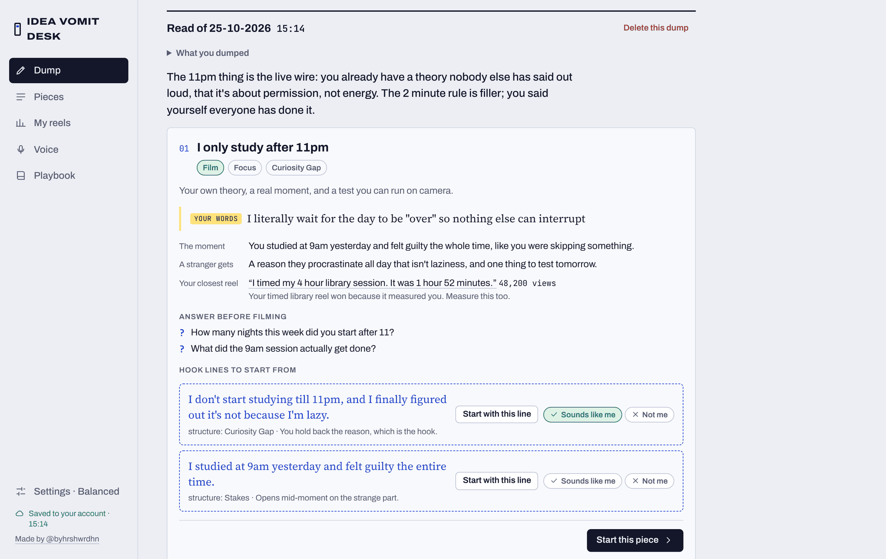

Every screenshot in this README uses a made-up creator, @studywithriya, so you can see the flow end to end.

---

## Set it up (about 5 minutes)

You need a Claude account (claude.ai or the Claude desktop app).

1. Download [`idea-vomit-desk.html`](idea-vomit-desk.html) from this repo (open it, then click the download button).
2. Open a new chat in Claude, attach the file, and paste this:

   > Publish this HTML file as a private artifact called "Idea Vomit Desk", exactly as it is, without changing the code. Give it the capabilities sample, db, user and downloads.

3. Open the page Claude gives you. When it asks to use Claude, allow it; that's how it writes.
4. Do the next two steps before anything else. They're what stop the hooks sounding generic.

---

## Step 1 · Teach it your voice

Go to **Voice**. Paste 5 to 10 of your own captions or reel transcripts. These are the evidence; everything else is a guess.

Optionally, copy the prompt it gives you into ChatGPT, Gemini and Claude, and paste back what each one says about how you talk.

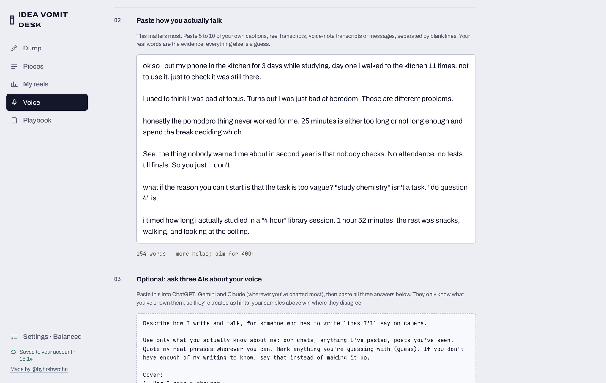

Press **Build my voice brief**. Your own words outrank what the AIs said, and anywhere they disagree it tells you. Edit the brief until it reads like you; this exact text goes into every hook and script request.

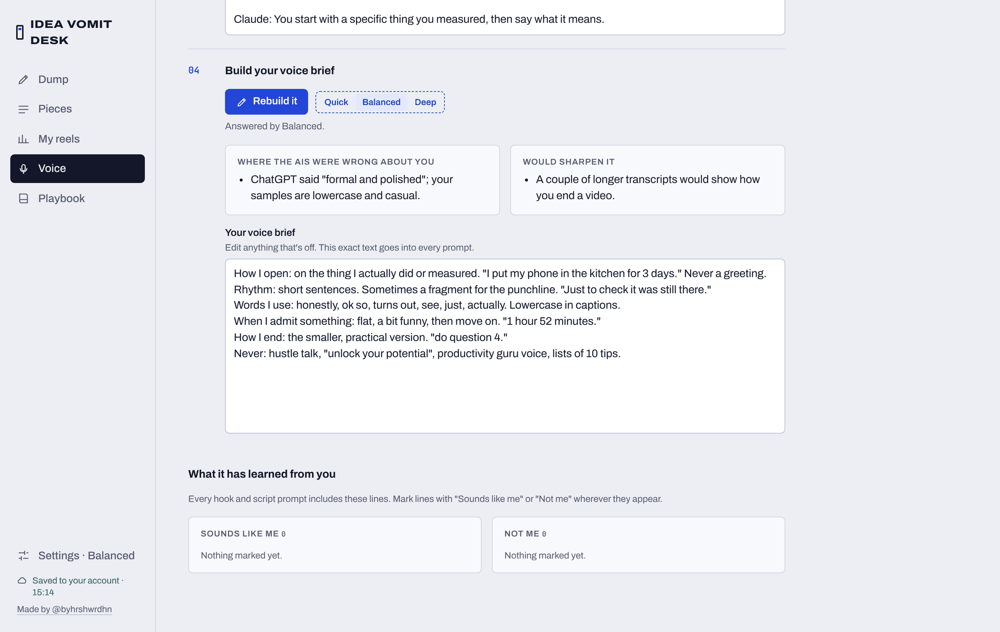

## Step 2 · Log your reels

Go to **My reels** and log some reels you've already posted: the hook and the numbers. Your best five and worst five are the most useful. Hook grading and idea reads get compared against these, and you can add a breakdown (hook style, structure, first 3 seconds) for each.

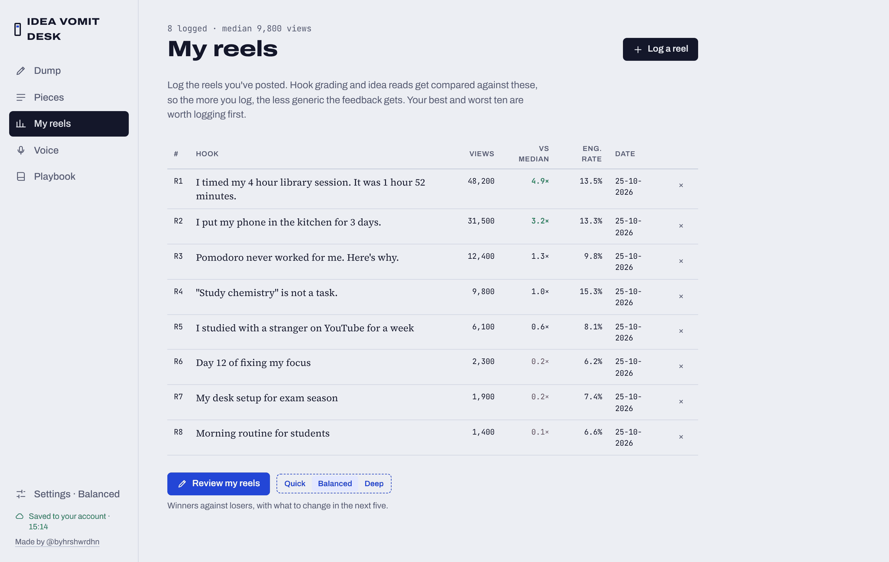

## Step 3 · Dump

Write whatever is in your head. Half sentences are fine. Pick a model next to the button: **Quick**, **Balanced** (default) or **Deep**.

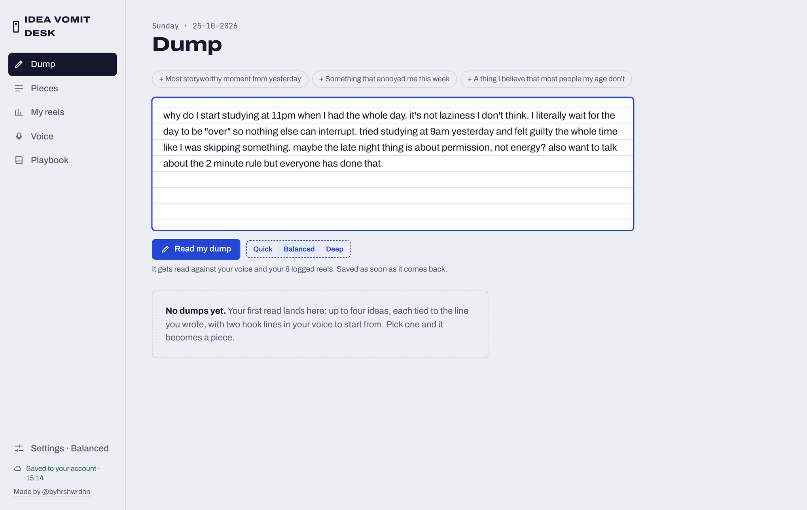

It finds up to four video ideas, says which to film and which to skip, quotes the line each one came from, and asks what's missing. Each idea comes with two hook lines built from your words. Mark them **Sounds like me** or **Not me** and it learns.

## Step 4 · Write and mark up the hook

**Start this piece** saves the idea as a piece: one page per video that keeps every version. On the Hook step, write what you'd say in the first 3 seconds, the text on screen and what people see. Quick checks run as you type.

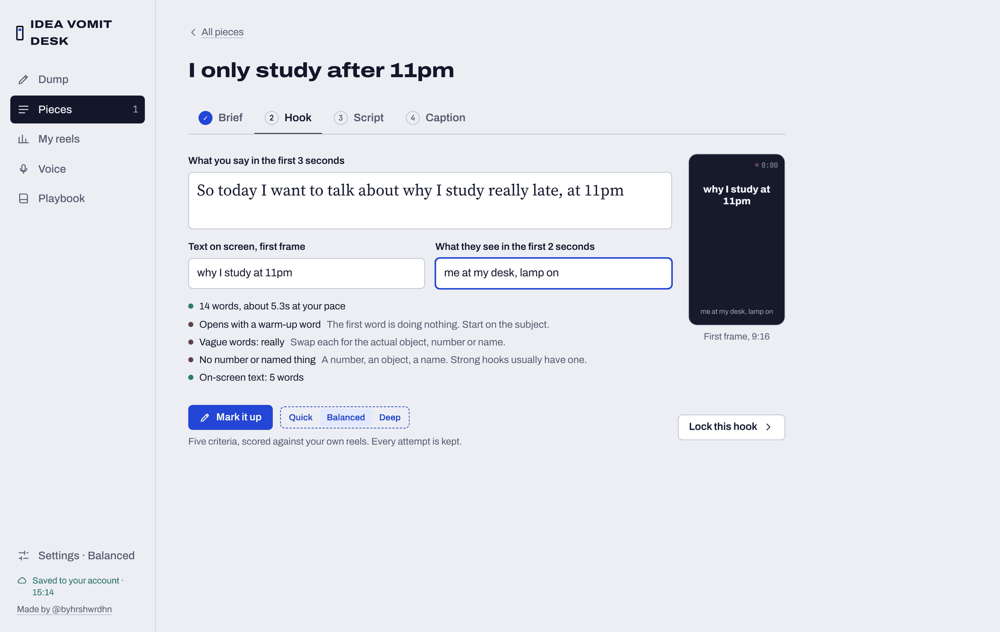

**Mark it up** scores it on five things: stops the scroll, opens a question, matters to a stranger, specific, works on mute. Weak words get underlined, and it compares the hook with your best reel.

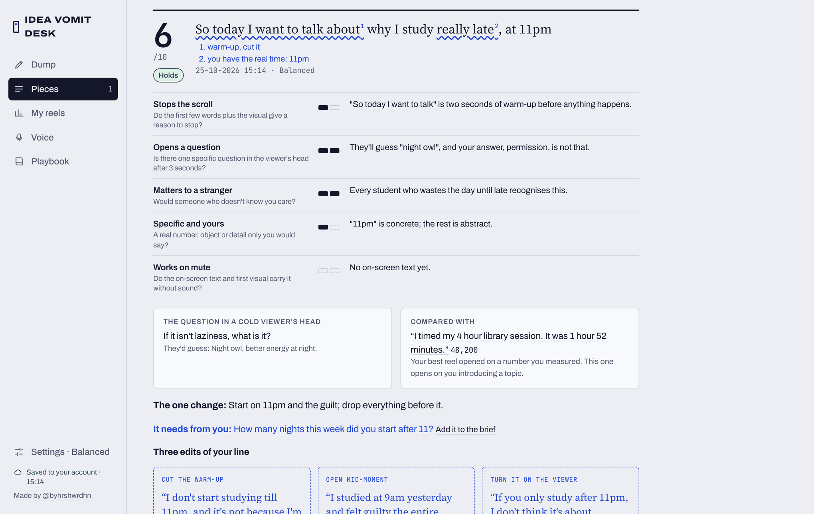

You get three edits of *your* line, each making one change, not three new hooks. Take one back to edit, or lock it.

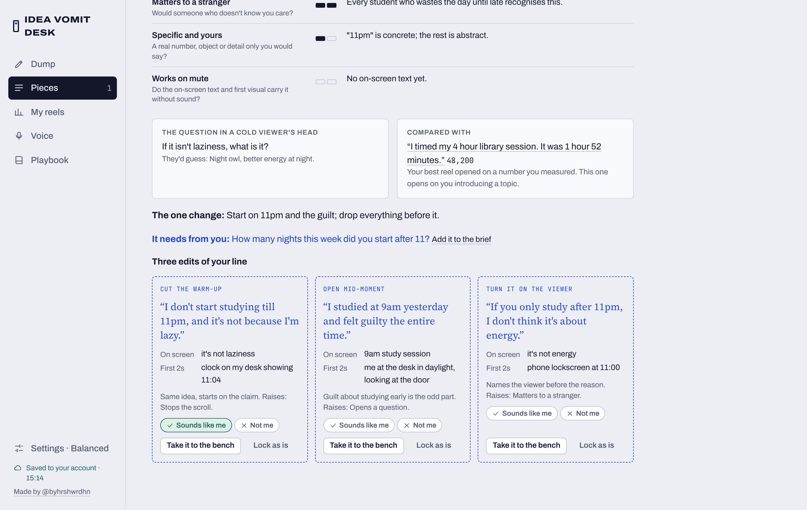

## Step 5 · Script

Choose where the script starts: your rough version, **Ask me first** (it interviews you, then builds only from your answers), or a draft from the hook.

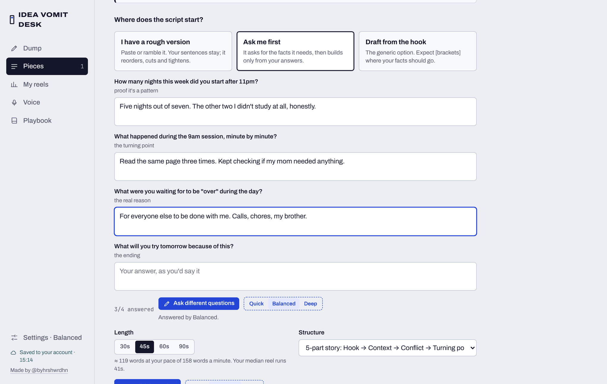

Lines from your words are marked **yours**. Lines it had to write are blue and marked **written for you**, so you always know what isn't you. Edit any line, rework a single line with a note, and every version is kept.

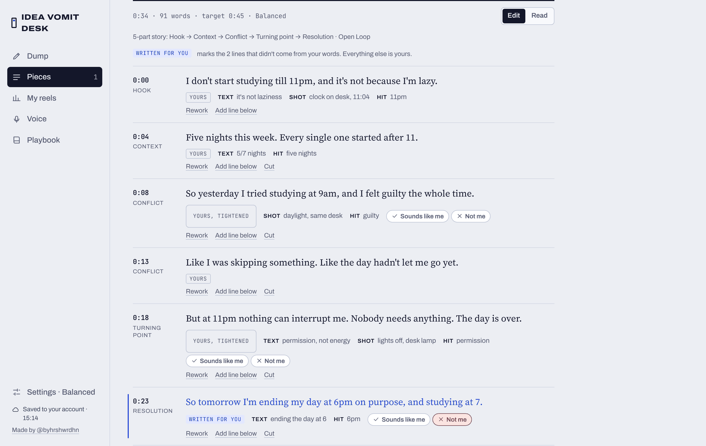

## Step 6 · Caption

Written from your own samples, in the shape you pick. Ask for another version and the old ones stay.

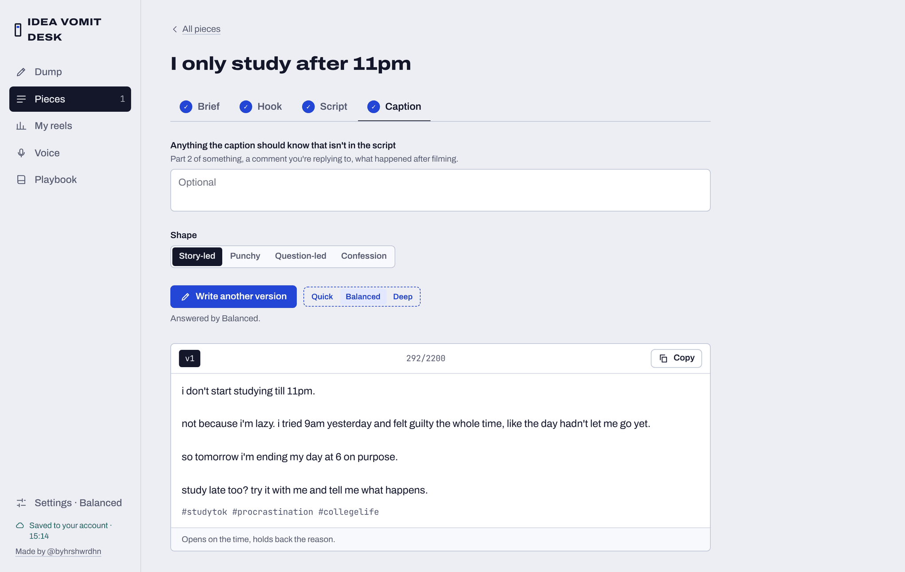

## Bonus · Playbook

20 short cards on hooks, story and filming, each with a drill to try on your next reel.

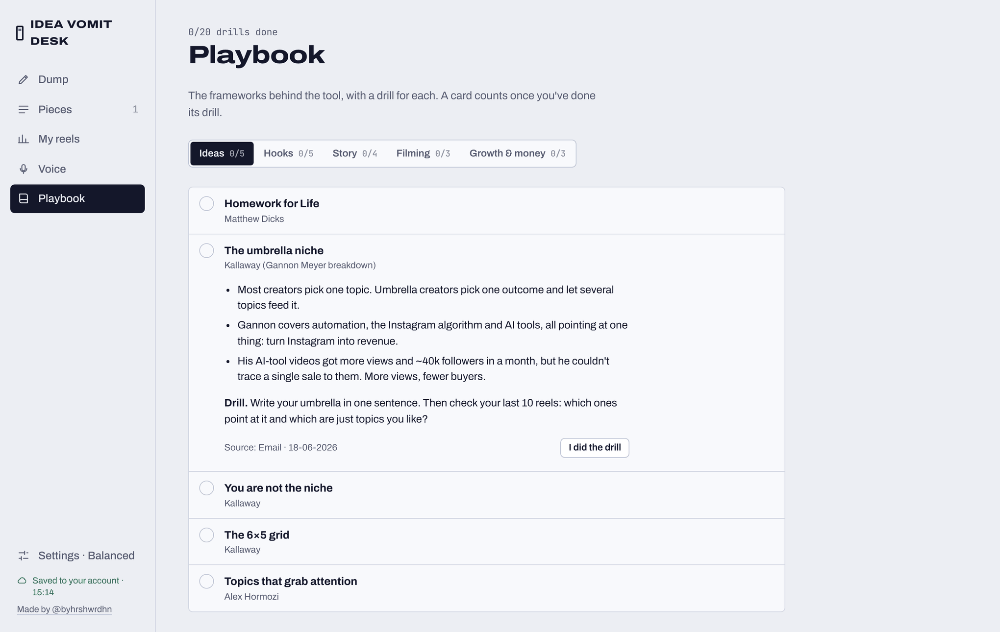

---

## Good to know

- Everything saves to your own Claude account. Use **Settings → Download a backup** now and then.
- Every request runs on your own Claude usage. Quick is cheapest; Deep is slowest and uses the most.
- It only works inside Claude. Opening the HTML file straight from your computer shows the app, but the writing won't work.
- If step 2 of the setup doesn't work on your Claude plan, open an issue and say what you saw.

## Hook templates

[HOOKS.md](HOOKS.md) has 40 fill-in hook templates, five for each of eight types. Use them for structure, then say the line out loud and rewrite anything that sounds like a template.

## License

MIT. Use it, change it, share it; keep the credit. See [LICENSE](LICENSE).

---

Made by Harshwardhan. I post about building things and testing them on myself: [@byhrshwrdhn on Instagram](https://www.instagram.com/byhrshwrdhn/).
